# Onsortkoi

**Ta ludothèque dans ta poche : le bon jeu pour la soirée, en quelques taps.**

Onsortkoi est une application Android qui reprend ta collection de jeux de société [MyLudo](https://www.myludo.fr) et t'aide à choisir quoi sortir selon la situation : combien vous êtes, combien de temps vous avez, l'âge du plus jeune joueur, l'envie du moment. Elle tient aussi l'inventaire de tes sleeves.

Tout fonctionne hors ligne. Seule la sauvegarde automatique, si tu l'actives, envoie une copie sur ton Google Drive.

  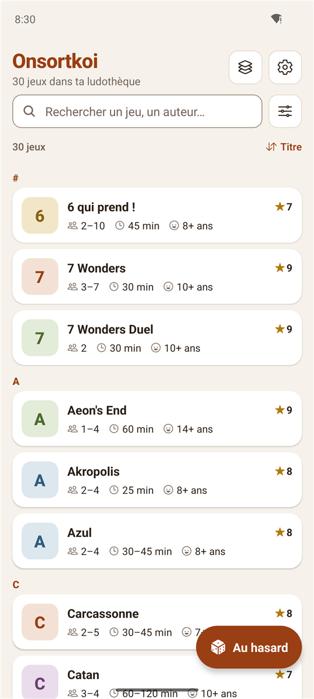
  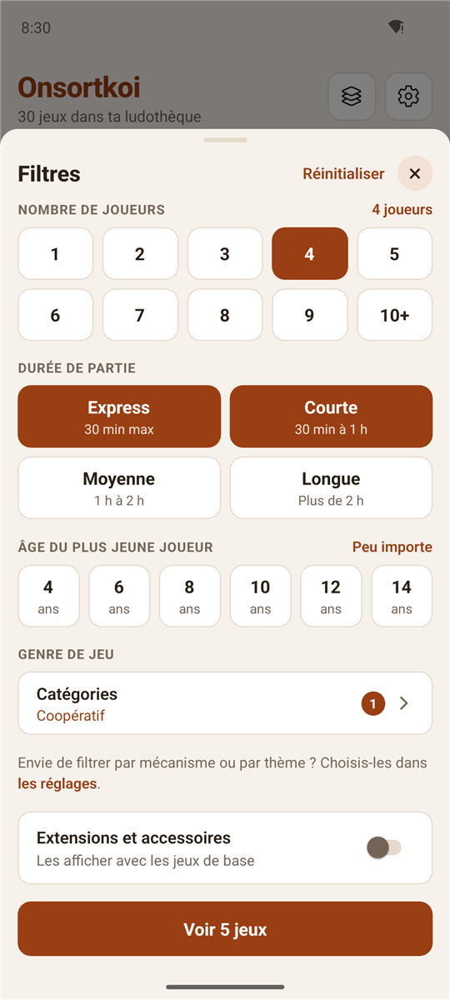
  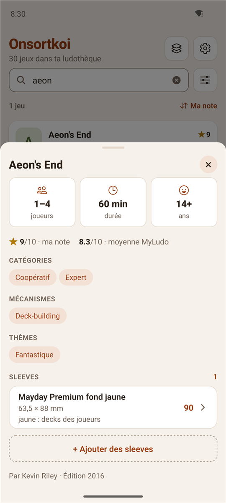

> Développeurs : voir [README-DEV.md](README-DEV.md).

## Sommaire

- [Installer l'app](#installer-lapp)
- [Démarrer](#démarrer)
- [Trouver un jeu](#trouver-un-jeu) : recherche, filtres, tri, tirage au sort, fiche d'un jeu
- [Sleeves](#sleeves)
- [Réglages](#réglages)
- [Sauvegarde et changement de téléphone](#sauvegarde-et-changement-de-téléphone)
- [Mises à jour](#mises-à-jour)
- [Confidentialité et sécurité](#confidentialité-et-sécurité)
- [Limites connues](#limites-connues)

## Installer l'app

Télécharge le fichier `.apk` de la dernière version sur la page [Releases](https://github.com/Forthtilliath/onsortkoi/releases), ouvre-le sur ton téléphone et autorise l'installation quand Android le demande.

Empreinte SHA-256 du certificat de signature, pour vérifier l'APK (`apksigner verify --print-certs`) :
`7D:64:4F:25:28:F8:71:29:6E:59:78:F8:91:AF:A0:76:73:D6:A0:BA:FD:58:27:D6:90:74:BD:0B:56:C7:40:95`

## Démarrer

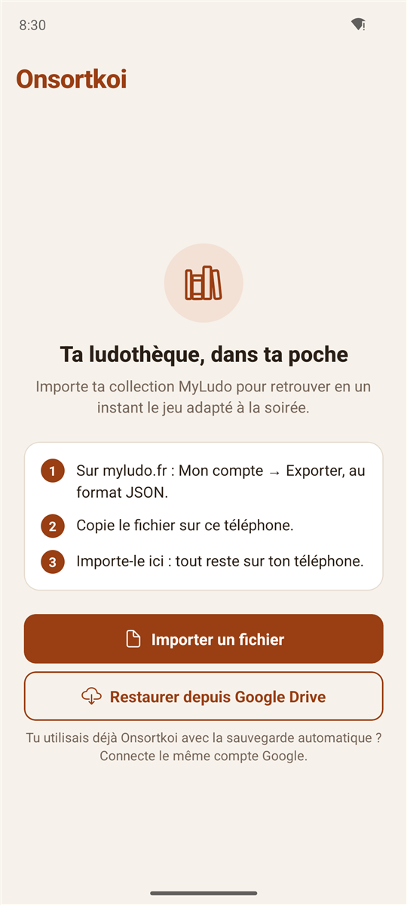

1. Sur [myludo.fr](https://www.myludo.fr) : *Mon compte → Exporter*, au format **JSON**.
2. Copie le fichier sur ton téléphone (ou dans ton Google Drive).
3. Dans Onsortkoi : **Importer un fichier**, puis choisis le fichier.

Tu utilisais déjà Onsortkoi ? **Restaurer depuis Google Drive** récupère ta sauvegarde automatique (connecte le même compte Google). Un fichier de sauvegarde se restaure aussi avec **Importer un fichier**.

 

## Trouver un jeu

La liste montre pour chaque jeu son nombre de joueurs, sa durée, l'âge conseillé et ta note. En haut, le nombre de jeux de ta ludothèque ; les icônes ouvrent **Mes sleeves** (calques) et les **Réglages** (engrenage).

### Recherche

La barre de recherche filtre par titre, sous-titre et auteur, sans tenir compte des accents ni des majuscules.

 

### Filtres

  
  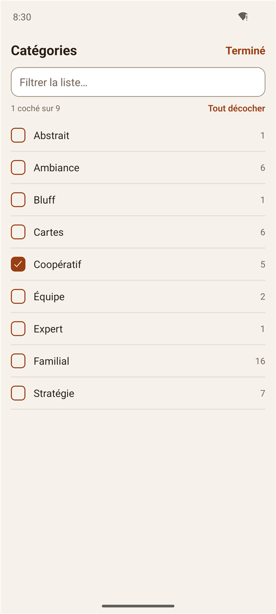
  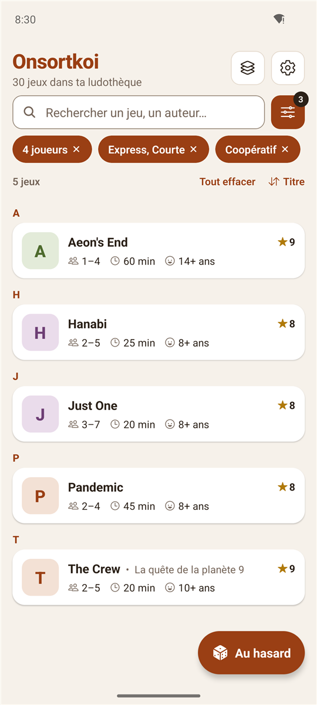

Le bouton à droite de la recherche ouvre le panneau des filtres. Un badge indique le nombre de critères actifs.

| Filtre | Fonctionnement |
| --- | --- |
| **Nombre de joueurs** | De 1 à 10+. Garde les jeux jouables à ce nombre ; **10+** garde ceux qui acceptent 10 joueurs ou plus. |
| **Durée de partie** | Express (30 min max), Courte (30 min à 1 h), Moyenne (1 h à 2 h), Longue (plus de 2 h). Plusieurs choix possibles : un jeu de 45 à 90 min apparaît en Courte comme en Moyenne. |
| **Âge du plus jeune** | 4 à 14 ans. Garde les jeux dont l'âge conseillé ne dépasse pas cet âge. |
| **Extensions et accessoires** | Masqués par défaut ; un interrupteur les affiche. |
| **Catégories, mécanismes, thèmes** | Listes à cocher, avec recherche et **Tout décocher**. Dans un même groupe, il suffit d'un tag (« Coopératif *ou* Deck-building ») ; entre groupes, tous doivent correspondre. |

À côté de chaque tag, un nombre indique combien de jeux resteront si tu le coches, en tenant compte des autres critères. Les tags qui ne donneraient aucun résultat sont masqués. Le bouton du bas annonce le nombre de jeux trouvés (« Voir 5 jeux »).

Sous la recherche, chaque critère actif s'affiche en puce : un tap sur la puce le retire, **Tout effacer** les retire tous (la recherche texte est conservée). Le nombre de jeux trouvés s'affiche à côté.

Un second tap sur une valeur déjà choisie (nombre de joueurs, âge) la désélectionne.

### Tri

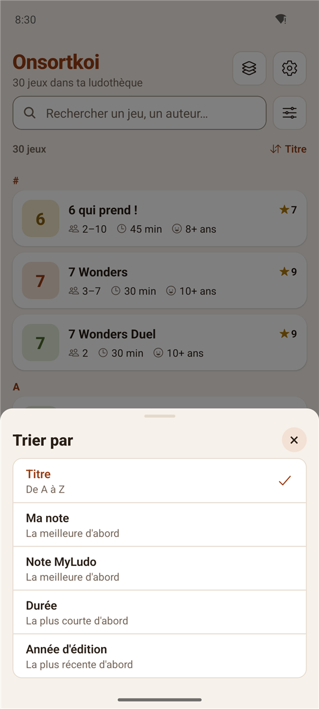

À droite du nombre de jeux, le bouton de tri range la liste par **titre** (de A à Z, avec une lettre repère qui reste en haut pendant le défilement), **ma note**, **note MyLudo**, **durée** (la plus courte d'abord) ou **année d'édition** (la plus récente d'abord). Les jeux sans la valeur triée passent en fin de liste.

 

### Tirer au sort

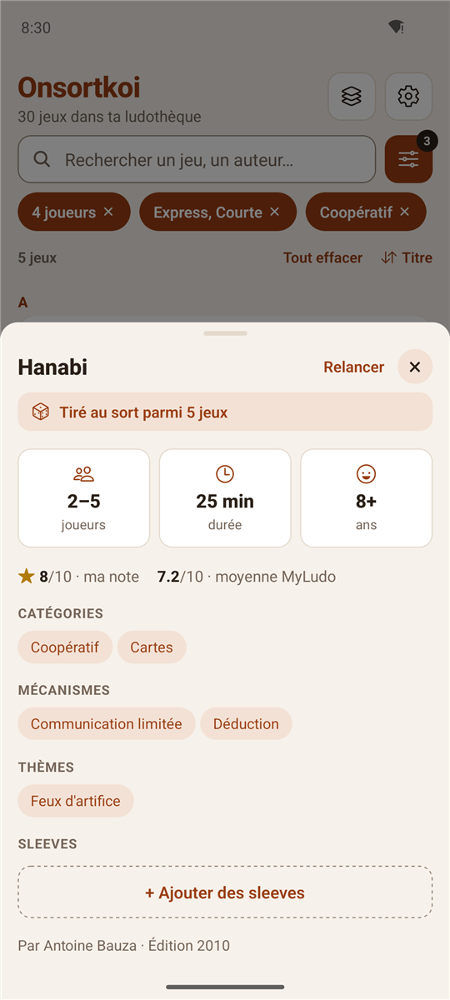

Le bouton **Au hasard**, en bas à droite, choisit un jeu parmi ceux affichés (donc selon les filtres en cours) et ouvre sa fiche (« Tiré au sort parmi 5 jeux »). **Relancer** en tire un autre, sans retomber sur le précédent.

 

### Fiche d'un jeu

Un tap sur un jeu ouvre sa fiche : joueurs, durée, âge, ta note et la moyenne MyLudo, catégories, mécanismes, thèmes, auteurs et année d'édition.

Un tap sur un tag de la fiche affiche tous les jeux de ta collection qui le portent.

La section **Sleeves** de la fiche liste les sleeves utilisées par ce jeu (avec leur note et leur stock), et **+ Ajouter des sleeves** en associe d'autres. Voir ci-dessous.

 

## Sleeves

  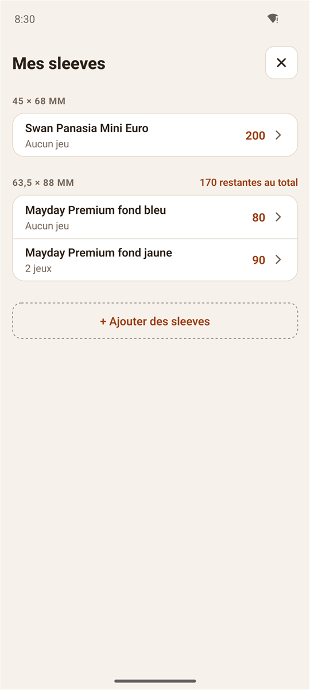
  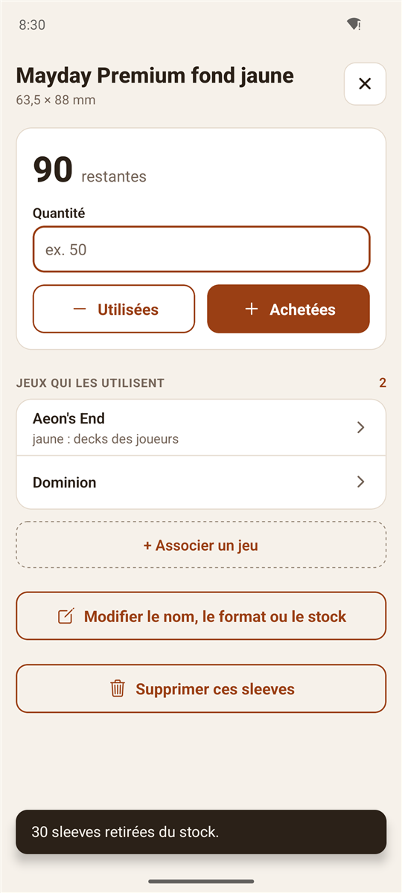
  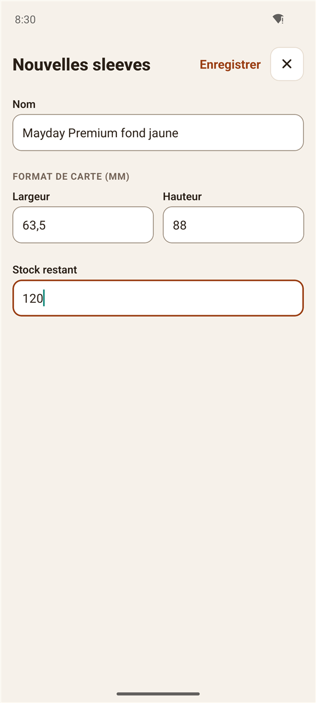

L'icône des calques, en haut à droite, ouvre **Mes sleeves** : le stock de protections de cartes qu'il te reste, pour savoir s'il faut en racheter avant de protéger un nouveau jeu.

- **Une entrée par produit** : nom libre (marque, gamme, couleur : « Mayday Premium fond jaune »), format en millimètres (largeur × hauteur, au dixième près : 63,5 × 88) et stock restant. Plusieurs produits peuvent avoir le même format.
- **Par format** : la liste regroupe les produits par format, du plus petit au plus grand, avec le stock total quand plusieurs marques partagent un format.
- **Stock** : dans la fiche d'un produit, saisis une quantité puis **Utilisées** (sleeves posées sur des cartes) ou **Achetées** (nouveau paquet). Un message confirme l'opération (« 30 sleeves retirées du stock. »). Seul le stock restant est suivi.
- **Jeux associés** : un même produit peut servir à plusieurs jeux, et un jeu peut utiliser plusieurs produits (ex. Aeon's End : fonds jaune, bleu, violet, transparent…). Chaque association porte une note facultative (« jaune : decks des joueurs ») pour savoir quelles sleeves reprendre avec une extension. L'association se fait depuis la fiche du produit (**+ Associer un jeu**) ou depuis la fiche du jeu.

Les sleeves sont enregistrées à part de la collection : **réimporter un export MyLudo ne les efface pas**. Un jeu qui a disparu de la collection reste associé et s'affiche comme « Jeu absent de la collection », à retirer à la main si besoin.

## Réglages

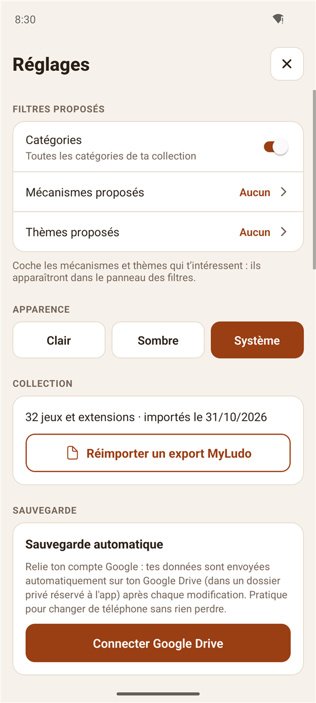

L'icône en haut à droite ouvre les réglages.

- **Filtres proposés** : les catégories sont toutes proposées (désactivables). Les mécanismes et thèmes sont souvent très nombreux : coche seulement ceux qui t'intéressent pour qu'ils apparaissent dans le panneau des filtres.
- **Apparence** : thème clair, sombre, ou celui du téléphone.
- **Collection** : nombre de jeux, date d'import, et **Réimporter un export MyLudo** pour mettre à jour la collection après des achats. L'app demande confirmation avant de remplacer la collection.
- **Sauvegarde** et **Mises à jour** : voir ci-dessous.

 

  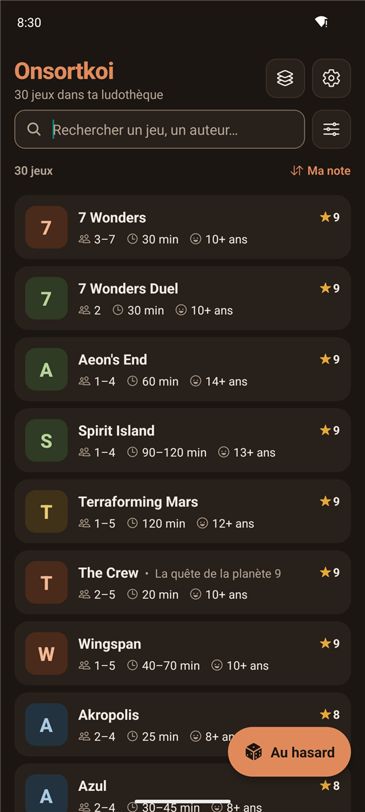

## Sauvegarde et changement de téléphone

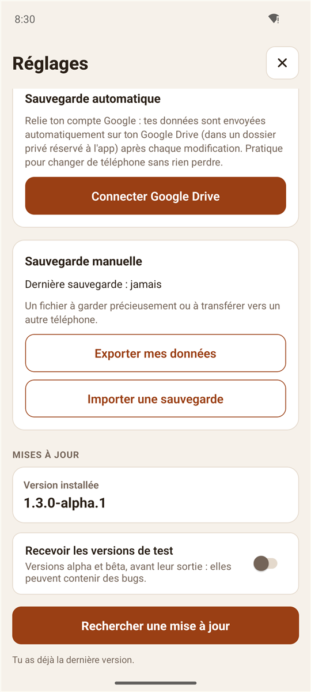

### Sauvegarde automatique (Google Drive)

Dans les réglages, **Connecter Google Drive** relie un compte Google. Ensuite, ta collection, tes réglages et tes sleeves y sont envoyés automatiquement après chaque modification (import, réglage changé, stock ou association de sleeves). Sans réseau, l'envoi attend le prochain lancement.

La copie est rangée dans un dossier privé de l'app : elle n'apparaît pas dans ton Drive, et l'app n'a accès à aucun autre de tes fichiers.

Sur un nouveau téléphone, **Restaurer depuis Google Drive** (écran d'accueil) récupère tout en connectant le même compte. **Déconnecter** arrête les envois ; la copie reste sur Drive.

### Sauvegarde manuelle (fichier)

**Exporter mes données** ouvre le menu de partage Android avec un fichier `Onsortkoi-sauvegarde-AAAA-MM-JJ.json`. **Importer une sauvegarde** le relit, après confirmation, et **Annuler la dernière restauration** remet les données d'avant.

 

## Mises à jour

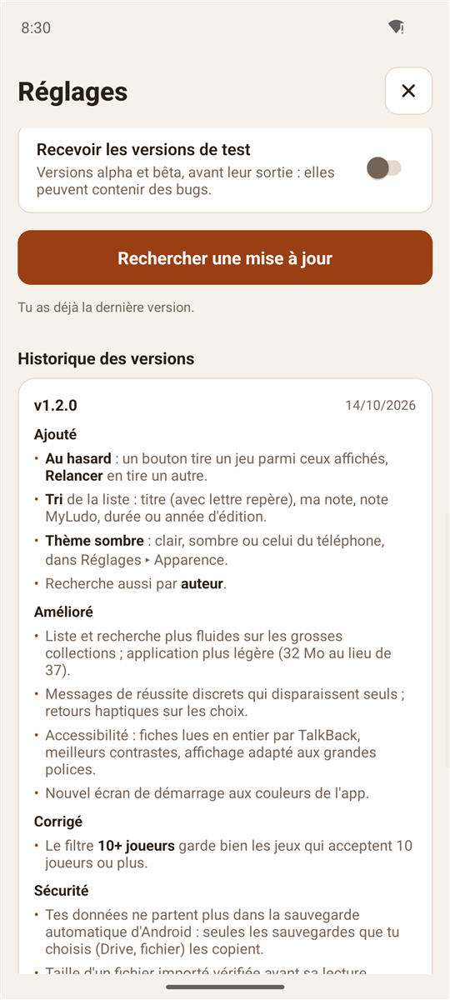

- **Au lancement**, au plus une fois toutes les 12 heures, l'app vérifie s'il existe une nouvelle version : une bannière propose **Installer** (téléchargement puis installation) ou **Ignorer** (cette version ne sera plus proposée, la suivante si).
- **Réglages ▸ Mises à jour** : version installée, vérification manuelle et historique des versions avec leurs nouveautés.
- **Recevoir les versions de test** : propose aussi les versions alpha et bêta, avant leur sortie. Désactivé par défaut ; elles peuvent contenir des bugs.
- Seules les releases officielles de ce projet sont proposées, et le fichier téléchargé est vérifié (empreinte SHA-256) avant installation. Android demande toujours ta confirmation.

 

## Confidentialité et sécurité

- **Réseau seulement pour la sauvegarde et les mises à jour** : rien n'est envoyé tant que tu ne connectes pas Google Drive. Une fois connecté, seuls ta collection, tes réglages et tes sleeves partent vers ton propre Drive (accès limité au dossier privé de l'app).
- **Aucune permission sensible** demandée ; l'accès au stockage, au micro et à la superposition d'écran est explicitement bloqué.
- **Pas de sauvegarde Android automatique** : seules les sauvegardes que tu actives (Drive, fichier) copient tes données hors du téléphone.
- **Données minimales** : seuls les champs utiles sont gardés de l'export MyLudo. Prix d'achat, propriétaire, commentaires et autres données personnelles sont ignorés à l'import.
- **Fichiers vérifiés** : chaque jeu d'un export ou d'une sauvegarde est contrôlé (types, bornes, longueurs ; 10 Mo et 5 000 jeux maximum, taille vérifiée avant même de lire le fichier). À la première anomalie, le fichier entier est refusé avec un message qui indique le jeu et le champ en cause, et **rien n'est modifié**.
- Les sleeves d'une sauvegarde sont contrôlées de la même façon (nom, format, stock, notes, jeux associés).
- Une sauvegarde créée par une version plus récente de l'app est refusée plutôt que mal interprétée. Les sauvegardes d'avant les sleeves (Onsortkoi 1.2 et antérieures) restent restaurables, sans sleeves.

## Limites connues

- Android uniquement.
- Collection en lecture seule : pour ajouter ou modifier un jeu, passe par MyLudo puis réimporte. Seules les sleeves se saisissent dans l'app.
- Seul le format d'export JSON de MyLudo est pris en charge.
